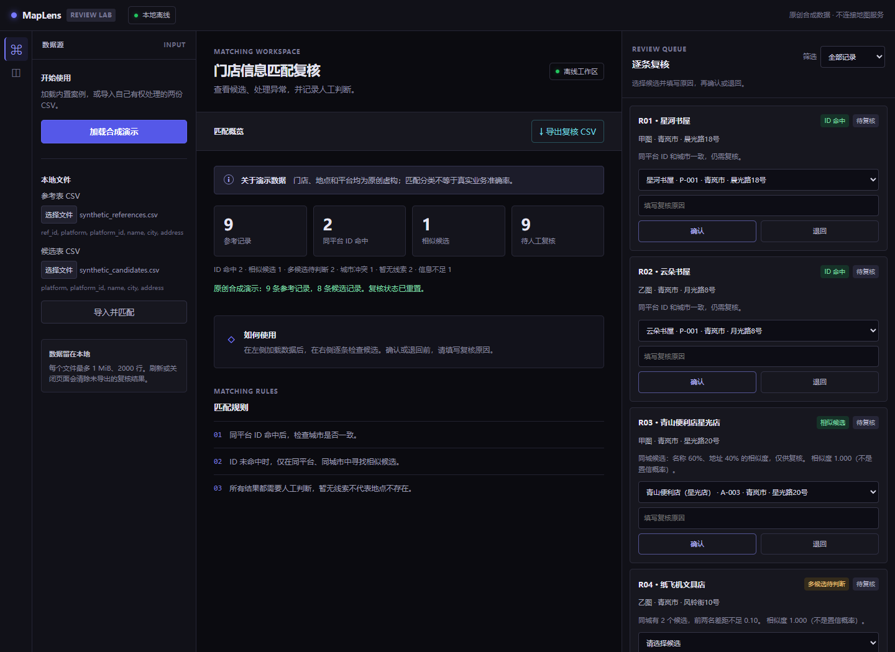
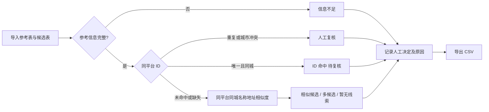

# 门店信息匹配复核台

一个离线运行的浏览器扩展与网页，把门店数据匹配拆成可解释的候选、冲突和人工复核。适合展示数据质量运营中的规则设计、异常分流与复核流程。**内置数据全部为原创虚构，演示结果不是业务准确率。**

## 项目背景与边界

项目受作者实习时使用的地图门店采集与匹配工具启发：作者确认当时使用的是全页版，原工具由作者借助 Claude 制作。本仓库由 Codex 独立重写，界面参考原全页版的深色工作台布局，用虚构数据展示通用的匹配与质检思路；它不是原工具或原 Claude 代码，不包含公司素材、真实门店数据、地图接口或自动采集功能，也不代表已验证的业务效果。

可用于练习同平台 POI 信息核对、理解候选生成与复核；不适合直接用于生产决策。示例中的「甲图」「乙图」、城市和门店均为虚构。

## 快速运行

无需安装依赖：下载仓库后，用现代浏览器直接打开 `index.html`，点击「加载合成演示」。也可导入两份自己有权处理的 UTF-8 CSV。浏览器扩展方式：打开 Chrome 的 `chrome://extensions`，开启开发者模式，选择「加载已解压的扩展程序」，选中本目录，然后点击扩展图标打开页面。**扩展加载在当前环境未验证**；网页操作已验证，详见 [测试报告](TEST_REPORT.md)。

1. 加载演示，查看候选及分类。
2. 选择候选并填写原因，确认或退回；暂无线索可记录「确认暂无线索」，只表示当前候选表中没有线索。
3. 点击「导出复核 CSV」。数据仅在页面内存中处理；刷新、关闭页面或重新导入会丢失未导出结果。导出不会保存未提交的复核原因草稿。

## 输入格式

参见 [参考表](examples/synthetic_references.csv) 和 [候选表](examples/synthetic_candidates.csv)。每份文件为 UTF-8 CSV，最多 1 MiB、2000 行。参考表须包含 `ref_id,platform,platform_id,name,city,address`，候选表须包含除 `ref_id` 外的同样字段。表头必须存在；参考表 `ref_id` 不能为空或重复。平台、名称或城市缺失时，该参考记录分类为信息不足；`platform_id` 和地址可以为空。导出的 CSV 会为公式开头的单元格加前缀，降低表格公式注入风险。

## 判断流程

- ID 仅在同一平台内比较；同平台 ID 重复或城市缺失、冲突进入人工处理。ID 命中也不是自动确认。
- ID 未命中或缺失时，仅在同平台、同城市生成模糊候选；字符二元组 Dice 相似度：名称 60%、地址 40%；任一地址缺失时只用名称。名称相似度至少 0.60，综合值至少 0.75。前两名相差不足 0.10 时标记多候选。这些是演示阈值，不是概率或经业务验证的标准。
- 分类为信息不足的记录可填写原因后退回；目前不能添加新候选。多候选显示的分数是最高候选分数；导出时，仅为单一推荐候选保留对应分数，人工选择其他候选时留空，避免分数错配。

## 演示结果和指标

加载内置数据时，9 条参考记录、8 条候选记录；每条参考记录恰好进入一个分类：ID 命中 2、相似候选 1、多候选 2、暂无线索 2、信息不足 1、城市冲突 1。初始 9 条待复核。

概览数量的分母为参考记录总数，候选表条数不作分母；待复核数是人工决定仍为 `pending` 的参考记录数。分类计数用于定位需处理的问题，不是正确率、召回率或真实业务效果。复核 CSV 包含参考信息、候选信息、规则原因、状态及已保存的人工决定与原因。真实准确率需要独立可信的标注集、明确的采样及人工复核标准。

## 测试与局限

运行 `node --test tests/core.test.cjs` 可检查核心规则；页面操作及测试环境见 [测试报告](TEST_REPORT.md)。主要限制：规则与阈值尚未在真实样本上校准；没有持久化、撤销、地理坐标或模型能力；数据只在本地处理，不能证明外部数据本身可公开。导出中的候选为建议或人工选择，需结合决定字段理解；不能将暂无线索当成真实不存在。后续优先用有明确授权的公开数据建立人工标注集，测量候选召回和复核一致性，再校准规则。

## 文件结构与许可

`core.js` 是匹配与 CSV 逻辑；`app.js`、`index.html`、`styles.css` 是本地界面；`manifest.json`、`background.js` 为扩展入口；`demo-data.js`、`examples/` 是原创虚构样例；`tests/` 为核心测试。公开前核对见 [清单](PUBLICATION_CHECKLIST.md)。

本仓库自行编写的代码、文档和原创虚构数据按 [MIT](LICENSE) 授权；不包含也不授权原实习项目代码、公司资料或第三方地图数据。
